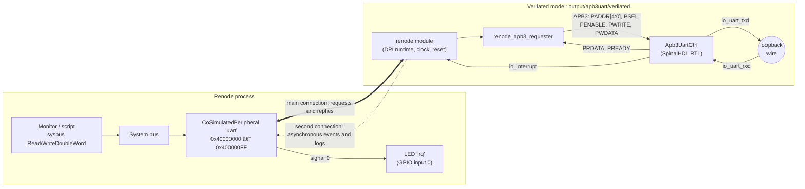
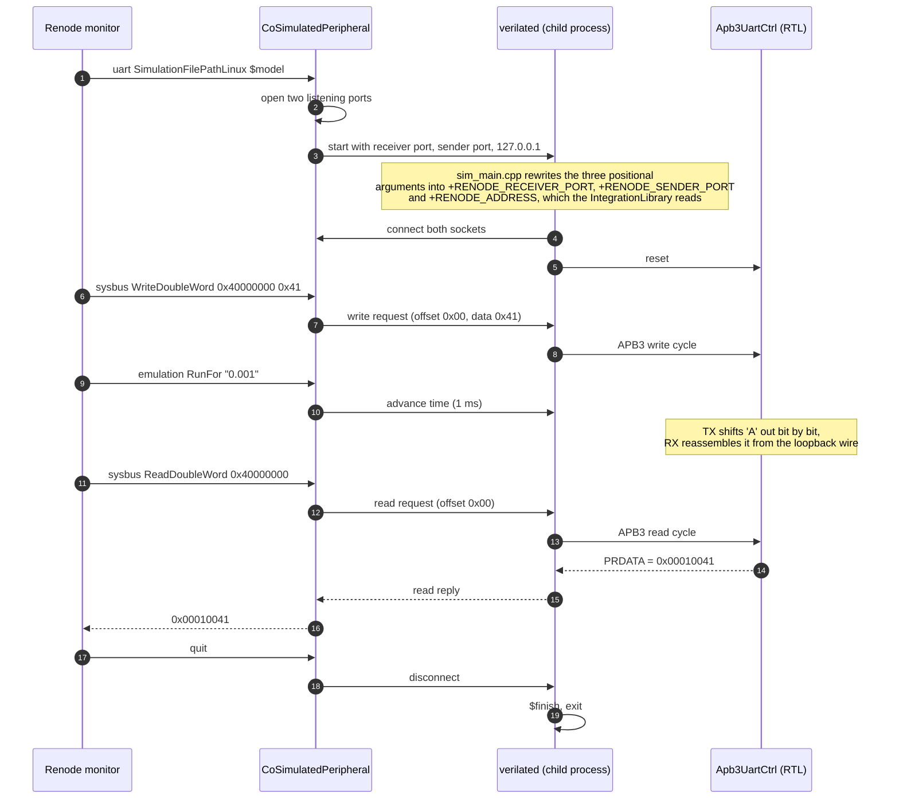
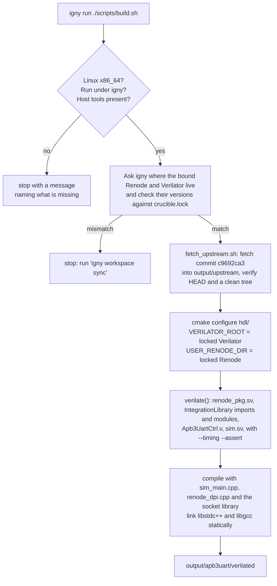
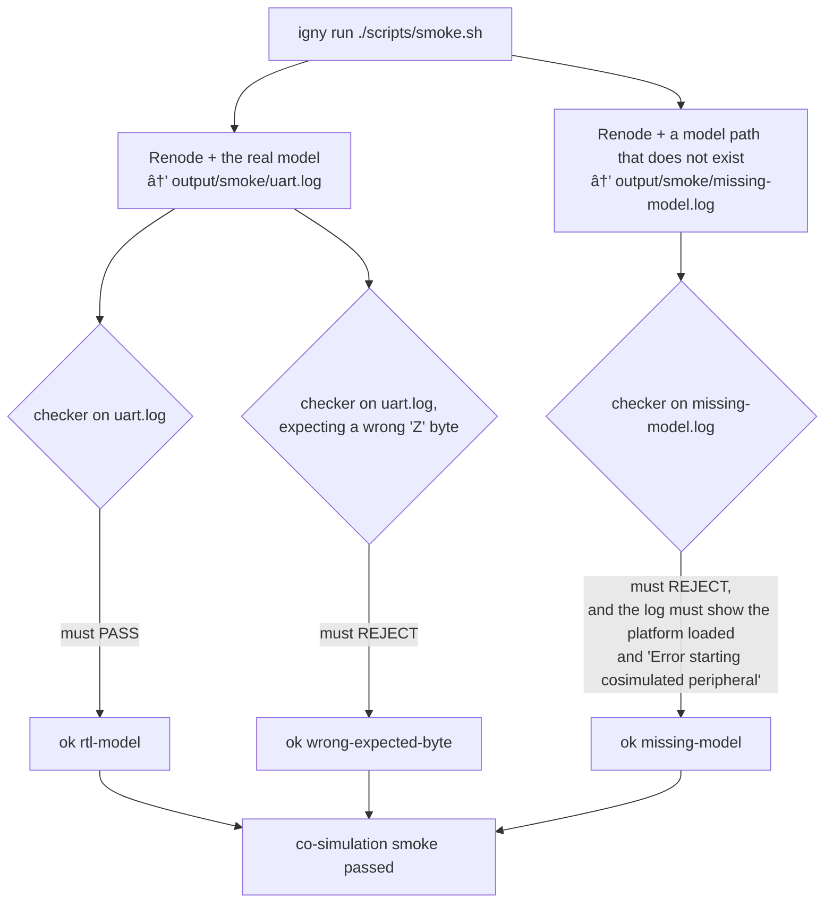

# UART co-simulation: Renode + Verilator under Crucible

Renode emulates the system and Verilator runs one real piece of RTL beside it.
The RTL here is a SpinalHDL APB3 UART controller. Renode reads and writes its
bus registers, and its interrupt pin comes back into Renode as a GPIO line.
Every value the demo checks comes out of the Verilated RTL, not out of a Renode
model.

It is a reference example: the smallest flow that proves the mechanism before
an accelerator or a whole SoC is swapped to RTL. The same pattern lets you keep
software running in Renode while you replace one modelled block at a time with
real SystemVerilog.

- [Quick start](#quick-start)
- [How it works](#how-it-works)
- [What runs](#what-runs)
- [Repository layout](#repository-layout)
- [Driving the UART yourself](#driving-the-uart-yourself)
- [What the smoke proves](#what-the-smoke-proves)
- [Bringing your own RTL](#bringing-your-own-rtl)
- [Troubleshooting](#troubleshooting)
- [Not covered](#not-covered)
- [Licence](#licence)

## Quick start

### Makefile workflow (Linux/WSL)

After entering Crucible, the Makefile runs the existing DPI build and smoke
scripts in the lock's `default` environment. It prepares Linux line endings
before build/run/smoke.

```sh
igny init
igny workspace sync
igny tool install make --env default
igny run make build
igny run make run
igny run make smoke
```

`igny run make run` runs the same 14 readbacks and two rejection controls while recording
`output/waves/cosim.vcd`. The waveform checker requires the received `A` and `Z`
values on the RTL read-data bus and low/high clock, serial and IRQ activity.
`igny run make sed` performs the line-ending preparation on its own.

To view the recorded waveform, bind the optional viewer and open it:

```sh
igny tool install gtkwave --env default
igny run make waves
```

`igny run make waves` opens an existing VCD; it does not run a separate behavioural bench.
It needs a graphical Linux/WSLg session. `igny run make clean` removes only generated
`output/`, including fetched upstream sources, models, logs and waveforms. It
preserves project sources and installed Crucible tools; the next build fetches
and compiles again. `igny run make help` lists the targets.

The direct script workflow remains available below. `IGNY_ENV` can select an
existing environment with the same locked tool versions, for example
`igny run make smoke IGNY_ENV=default`.

**You need:**

- Linux x86_64. Nothing else has been measured.
- Crucible beta (`igny`), with this Makefile workflow measured on 1.0.0.
- These build prerequisites on PATH: `cmake` 3.19 or newer, `make`,
  a C++ compiler (`c++`), `perl`, `python3`, `git` and `timeout`. `build.sh`
  checks for them and names any that are missing.
- Network access for the first build. It fetches one upstream commit from
  GitHub (about 0.5 MB), and `igny workspace sync` downloads the two locked
  tools.

**Run:**

```sh
git clone <this repository> uart-renode-verilator-cosim
cd uart-renode-verilator-cosim
igny workspace sync              # install the locked Renode and Verilator
igny run ./scripts/build.sh      # verilate the UART into output/apb3uart/verilated
igny run ./scripts/smoke.sh      # run it under Renode and judge the result
```

A passing run ends with:

```text
ok    rtl-model: pass
        PASS …/output/smoke/uart.log: 14 reads match the RTL
ok    missing-model: reject
ok    wrong-expected-byte: reject
co-simulation smoke passed
```

Always launch the scripts through `igny run`, which puts the locked Renode and
Verilator on `PATH`. Run directly, they stop and tell you so. `build.sh` also
refuses to run if the bound versions differ from `crucible.lock`.

## How it works

This demo uses Renode's **DPI IntegrationLibrary**, the co-simulation path
Antmicro maintains (see [antmicro/renode-dpi-examples](https://github.com/antmicro/renode-dpi-examples)).
The older C++ bridge (`renode_bus.cpp`) no longer builds against Renode 1.17.

### Two processes, two sockets

Renode and the Verilated model are separate processes. Renode's
`CoSimulatedPeripheral` owns an address window on the system bus. Each bus
access in that window becomes a message to the model, and inside the model
Renode's SystemVerilog modules turn the message into a real APB3 transaction on
the UART's pins.

The two processes talk over two TCP connections on `127.0.0.1`:

- **The main connection carries requests and their replies, in both
  directions.** A bus read goes to the model on it, and the read data comes
  back on the same connection.
- **The second connection carries asynchronous messages** from the model to
  Renode, such as signal changes and log lines.



- [`hdl/sim.sv`](hdl/sim.sv) is the simulation top:
  - Renode's `renode` and `renode_apb3_requester` modules drive the UART's APB3
    port. The bus is 20 bits wide, and the UART decodes `PADDR[4:0]`.
  - The clock is 50 MHz and reset is `!presetn`.
  - **TX is wired to RX**, so every byte written to the UART is serialised,
    crosses the wire bit by bit and is reassembled by the receiver. A correct
    read-back exercises both state machines.
  - The interrupt pin is fed back to Renode as GPIO input 0.
- [`scripts/uart_cosim.repl`](scripts/uart_cosim.repl) puts the UART on
  Renode's system bus at `0x40000000` (256 bytes, 32-bit accesses) and routes
  co-simulation signal 0 to an LED named `irq`.
- [`hdl/sim_main.cpp`](hdl/sim_main.cpp) is the Verilator main loop. It runs
  until the model finishes; `sim.sv` calls `$finish` when Renode disconnects.

### How Renode starts the model

You never start the model yourself. `uart_cosim.resc` sets
`uart SimulationFilePathLinux <model>`, and Renode launches it as a child
process, connects, and stops it when the emulation ends.



The positional-to-plusarg rewrite lets Renode launch and stop the model itself,
so no Robot driver is needed. Plusargs given directly pass through unchanged.
The main loop also records VCD when `COSIM_TRACE_FILE` is set; `igny run make run` sets
that variable to the project waveform path. Ordinary smoke runs do not record
a waveform.

### Time only moves when Renode moves it

The model's clock advances only while Renode's virtual time does. A register
write is delivered at once, but the UART needs simulated time to shift a byte
across the loopback wire. That's why the script calls `emulation RunFor "0.001"`
after each write. In testing, steps of 0.1 ms or less did not reach the model;
1 ms steps always did.

## What runs

| Piece | Exactly what | Pinned by |
| --- | --- | --- |
| Renode | 1.17.0 | `crucible.lock` (artifact sha256 `2ef52c64…`) |
| Verilator | 5.052 | `crucible.lock` (artifact sha256 `0bdb24ee…`) |
| UART RTL | `samples/apb3uart/Apb3UartCtrl.v` from [antmicro/renode-verilator-integration](https://github.com/antmicro/renode-verilator-integration), MIT | `upstream.env` (commit `c9692ca3`) |
| Co-simulation glue | Renode's own DPI IntegrationLibrary (`plugins/IntegrationLibrary`), plus `hdl/` here | the locked Renode |

Only the one Verilog file is taken from upstream. It is fetched, not copied
into this repository. The build refuses any commit other than the pinned one,
and refuses a modified checkout.

### What `build.sh` does



Two details in [`hdl/CMakeLists.txt`](hdl/CMakeLists.txt) are deliberate:

- **The IntegrationLibrary modules are listed as sources.** Upstream's recipe
  finds them through Verilator's `-y` search instead, and Verilator 5.047 and
  5.052 then drop the file-scope `import renode_pkg::…` lines of the
  auto-loaded files.
- **The C++ runtime is linked statically, as upstream does.** Renode starts the
  model with Renode's own library path, which puts Renode's bundled
  `libstdc++` first. A model linked dynamically against a newer host
  `libstdc++` then fails to start (`GLIBCXX_… not found`).

## Repository layout

```text
.
├── crucible.toml              Crucible workspace: one environment, "default"
├── crucible.lock              exact Renode and Verilator artifacts (sha256)
├── upstream.env               pinned upstream URL, commit and sample path
├── hdl/
│   ├── sim.sv                 simulation top: Renode DPI modules + UART + loopback
│   ├── sim_main.cpp           Verilator main loop and launch-argument rewrite
│   └── CMakeLists.txt         verilates everything into one executable
├── scripts/
│   ├── build.sh               checks, fetch, configure, build (run via igny)
│   ├── fetch_upstream.sh      fetch and verify the pinned upstream commit
│   ├── smoke.sh               run the co-simulation and its two controls
│   ├── check_uart_log.py      judge a Renode log against the expected values
│   ├── uart_cosim.repl        Renode platform: the UART on the bus + irq LED
│   ├── uart_cosim.resc        Renode script: load, reset, 14 labelled reads
│   └── _common.sh             shared paths and checks (sourced, not run)
├── tests/
│   └── test_check_uart_log.py unit tests for the checker
├── output/                    everything generated (gitignored)
│   ├── upstream/              the fetched upstream checkout
│   ├── apb3uart/verilated     the co-simulation model
│   └── smoke/                 Renode logs and checker verdicts
├── LICENSE                    Apache License 2.0
└── NOTICE                     attribution for adapted and fetched sources
```

## Driving the UART yourself

Start Renode with the platform loaded and use the monitor:

```sh
igny run renode --disable-xwt --plain --console -e 'include @scripts/uart_cosim.resc'
```

```text
(apb3uart-cosim) sysbus WriteDoubleWord 0x40000000 0x21
(apb3uart-cosim) emulation RunFor "0.001"
(apb3uart-cosim) sysbus ReadDoubleWord 0x40000000
0x00010021
(apb3uart-cosim) emulation RunFor "0.001"
(apb3uart-cosim) quit
```

The included script already runs the full check sequence first. To load a
different model, set `$model` before including it:
`$model = @/path/to/verilated; include @scripts/uart_cosim.resc`.

### Register map

Offsets from `0x40000000`, as the SpinalHDL `Apb3UartCtrl` defines them and as
the script uses them:

| Offset | Name | Write | Read |
| --- | --- | --- | --- |
| `0x00` | DATA | byte to transmit | `[16]` RX valid, `[7:0]` received byte (pops the RX FIFO) |
| `0x04` | STATUS | `[1:0]` interrupt enables (RX, TX) | `[31:24]` RX FIFO occupancy, `[23:16]` TX FIFO free slots, `[9:8]` pending interrupts (RX, TX), `[1:0]` enables |
| `0x08` | CLOCK_DIVIDER | baud divider (the script uses 0, the fastest) | |
| `0x0C` | FRAME | frame format (the script uses 7: 8 data bits, no parity, one stop bit) | |

Quitting straight after a register access makes the model print
`%Error: … Unexpected channel disconnection` as it shuts down. A `RunFor`
before `quit` avoids it.

## What the smoke proves

[`scripts/uart_cosim.resc`](scripts/uart_cosim.resc) resets the UART, then
reads 14 values back from the RTL: 9 register reads and 5 states of the
interrupt line. Each value is preceded by an `echo` label, so the checker
knows which value it is looking at.

| Label | Value | Meaning |
| --- | --- | --- |
| STATUS reset | `0x00200000` | TX FIFO has 32 free slots; interrupts off |
| IRQ reset | `False` | |
| STATUS tx+rx irq enabled | `0x00200103` | Enables set; TX-empty interrupt pending |
| IRQ tx empty | `True` | The RTL raises its interrupt pin |
| STATUS rx irq enabled | `0x00200002` | |
| IRQ nothing received | `False` | Nothing received yet |
| STATUS irqs disabled | `0x00200000` | |
| DATA rx empty | `0x00000000` | RX not valid |
| DATA 'A' still on the wire | `0x00000000` | The byte is still being shifted across |
| DATA rx 'A' | `0x00010041` | RX valid (bit 16) + `0x41` |
| STATUS 'Z' waiting | `0x01200202` | One byte in the RX FIFO; RX interrupt pending |
| IRQ rx pending | `True` | |
| DATA rx 'Z' | `0x0001005A` | RX valid + `0x5A` |
| IRQ rx drained | `False` | Reading the byte cleared the interrupt |

Renode exits 0 even when the co-simulated model fails to start, so the exit
status proves nothing. [`scripts/check_uart_log.py`](scripts/check_uart_log.py)
passes a run only when all of these hold:

- all 14 labelled values match, in order and with the right type (a register
  value never equals a `True`/`False` line state);
- the script reached its `UART_COSIM_DONE` end marker;
- Renode logged no `[ERROR]`, monitor error or `Operation timeout`, and the
  model printed no `%Error`.

`smoke.sh` runs three cases, and succeeds only if each gives its expected
result:



| Case | Expected | Why |
| --- | --- | --- |
| The real model | pass | The demo works |
| The same script with a missing model | reject, because the model could not start | A model that is not running cannot pass |
| The real log, judged against a wrong `Z` byte | reject | The checker compares values, not just shape |

Logs land in `output/smoke/`. The checker has its own unit tests:

```sh
python3 -m unittest discover -s tests
```

## Bringing your own RTL

The demo is laid out so that the UART is the only part specific to this
example. To co-simulate another APB3 peripheral:

1. **Replace the DUT in [`hdl/sim.sv`](hdl/sim.sv).** Keep the `renode`,
   `renode_apb3_if` and `renode_apb3_requester` instances. Connect your
   module's APB3 port to `apb3` (use as many `paddr` bits as your register
   window decodes), and its interrupt to `renode_inputs`. To feed several
   interrupts, raise `RenodeInputsCount` and widen `cosimToRenodeSignalRange`
   in the `.repl`.
2. **Point the build at your sources.** The UART is wired in at three places.
   Change all three, or configuration fails on the missing UART file. For RTL
   kept in this repository, for example `hdl/my_periph.sv`:
   - In [`hdl/CMakeLists.txt`](hdl/CMakeLists.txt), remove `${UART_RTL}` from
     the `foreach(required …)` preflight list.
   - In the same file, replace `${UART_RTL}` in `verilate(… SOURCES …)` with
     your files, for example `${CMAKE_CURRENT_SOURCE_DIR}/my_periph.sv`.
   - In [`scripts/build.sh`](scripts/build.sh), delete the
     `"${DEMO_DIR}/scripts/fetch_upstream.sh"` line, and remove the
     `-DUART_RTL=…` argument from the `cmake -S …` command, together with the
     `\` that continues the line before it.

   If your RTL comes from another repository, keep `fetch_upstream.sh`. Point
   `upstream.env` at that repository and commit, and pass your file through
   `-DUART_RTL` (or a variable of your own) as the demo does.
3. **Place it on the bus.** In [`scripts/uart_cosim.repl`](scripts/uart_cosim.repl),
   set the address window (`@ sysbus <base, +size>`) and `maxWidth` to match
   your peripheral.
4. **Write the checks.** Replace the reads in
   [`scripts/uart_cosim.resc`](scripts/uart_cosim.resc) with your own sequence.
   Keep a labelled `echo` before every value. Update `EXPECTED` in
   [`scripts/check_uart_log.py`](scripts/check_uart_log.py), and keep the
   missing-model and wrong-value controls in `smoke.sh` so a broken setup
   can't pass.

The IntegrationLibrary also has modules for AHB and AXI
(`plugins/IntegrationLibrary/hdl/modules/`). This demo only measures APB3.

## Troubleshooting

| Symptom | Cause | Fix |
| --- | --- | --- |
| `run this through Crucible so the locked tools are on PATH` | A script was run directly | `igny run ./scripts/build.sh` (or `smoke.sh`) |
| `<tool> X is bound here but crucible.lock pins Y` | The environment has a different version bound | `igny workspace sync` |
| `missing host prerequisite(s): …` | A host tool is not installed | Install it with your system package manager |
| CMake: `CMake 3.19 or higher is required` | Host CMake is too old for Verilator's own CMake package | Install CMake 3.19 or newer |
| `Error starting cosimulated peripheral` in the Renode log | The model was not built, or `$model` points at the wrong file | Run `build.sh`; check `output/apb3uart/verilated` exists |
| A read returns the old value after a write | Renode's virtual time did not advance far enough | `emulation RunFor "0.001"` between the write and the read |
| `%Error: … Unexpected channel disconnection` at quit | Quit straight after a bus access | Add a `RunFor` before `quit` |
| `GLIBCXX_… not found` when Renode starts a model you built yourself | The model links `libstdc++` dynamically and Renode's bundled one comes first | Keep `-static-libstdc++ -static-libgcc`, as in `CMakeLists.txt` |
| The smoke's `rtl-model` case fails but Renode exited 0 | Expected: Renode's exit status says nothing about the model | Read `output/smoke/rtl-model.check` and `uart.log` |

## Not covered

- **Other platforms:** Windows and macOS are unmeasured.
- **A separate serial source:** bytes reach the receiver only through the
  loopback wire. Feeding them from a Renode UART model needs a terminal
  bridge in the testbench, which this demo does not have.
- **Flows:** no `igny run sim` flow is shipped. The demo runs the individual
  tools and its scripts through `igny run`.
- **Portability of the model:** `verilated` is built on your machine with your
  compiler. It is a local build output, not a distributable artifact.
- **Timing:** this demo checks register values, received bytes and the
  interrupt line only. It makes no claim about cycle accuracy.

## Licence

Apache License 2.0; see `LICENSE`. `hdl/sim_main.cpp` and `hdl/sim.sv` are
adapted from Antmicro's Apache-2.0
[renode-dpi-examples](https://github.com/antmicro/renode-dpi-examples). The
UART RTL is fetched at build time from Antmicro's MIT-licensed
[renode-verilator-integration](https://github.com/antmicro/renode-verilator-integration)
and is not part of this repository. Details are in `NOTICE`.
